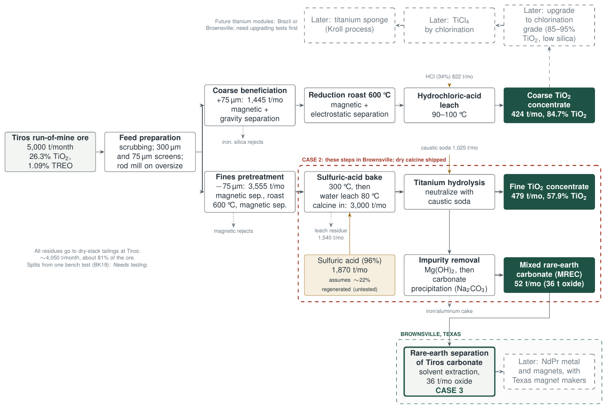
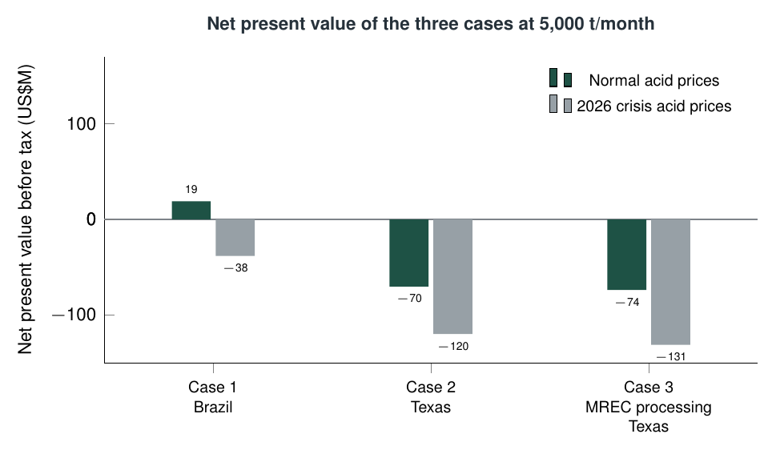
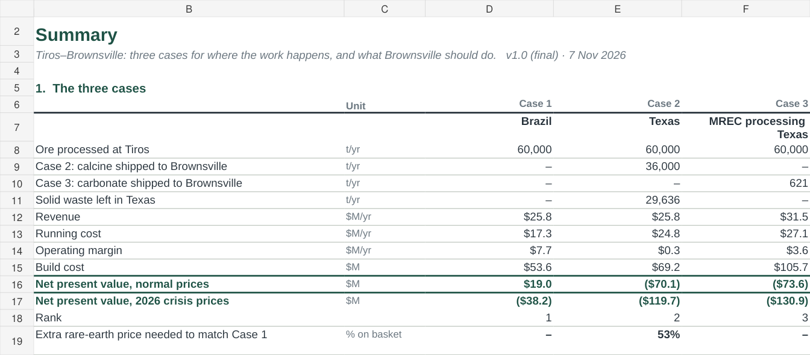
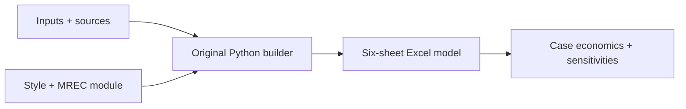

# Tiros–Brownsville | Process Design & Techno-Economic Analysis

**Colorado Impact Challenge · Resouro Strategic Metals · November 2026**  
**Team:** Jacob Dold (University of Colorado Boulder), Lukas Hirschmann and Mathias Bauer (Colorado School of Mines)

A submission-backed engineering study of how the Tiros titanium and rare-earth deposit in Minas Gerais, Brazil could be processed, and whether moving stages of production to **Brownsville, Texas** creates economic value. The project combines conceptual process engineering, a Python-generated financial model, scenario analysis, primary-source research, and a prioritized pilot-testing plan.

> **Project status:** Completed competition submission (7 November 2026). The PDF and Excel workbook below are the **exact submitted files**, not reconstructed versions. Economic values are pre-tax screening estimates based on stated inputs and assumptions; they do not demonstrate validated plant feasibility.

## Start here — final competition deliverables

| Deliverable | File | What it contains |
|---|---|---|
| **Technical report** | [Final 14-page report](report/tiros_brownsville_report.pdf) | Process assessment, flowsheet, technology decision matrix, economic results, testing recommendations |
| **Editable model** | [Final v1.0 Excel workbook](model/Tiros_Brownsville_Model.xlsx) | 48 modeled inputs, six worksheets, normal/crisis price cases, throughput sensitivity, rare-earth module |
| **Source code** | [Original Python model generator](model/build/build_model.py) | Reproducible workbook layout, cell formulas, source-linked input ledger and charts |

The report was built in LaTeX from the [original report source](report/tiros_brownsville_report.tex). The model generator is included with its original [inputs](model/build/inputs.py), [sources](model/build/sources.py), [style system](model/build/style.py), and [MREC separation module](model/build/mrec_block.py).

## Problem and engineering alternatives

The competition posed a combined processing-location and technology-selection question: how to recover **titanium concentrates and mixed rare-earth carbonate** from Tiros ore, while exploring possible industrial activity in Brownsville.

| Case | Processing arrangement | Principal tradeoff |
|---|---|---|
| **1. Brazil** | Process ore in Brazil; sell titanium concentrates and mixed rare-earth carbonate (MREC) | Avoid cross-border intermediate shipping and duplicate process facilities |
| **2. Texas** | Roast fines in Brazil; ship dry calcine to Brownsville for sulfuric-acid processing | Shifts the acid circuit to Texas but adds freight and site costs |
| **3. MREC Processing Texas** | Produce concentrates and MREC in Brazil; ship MREC to Brownsville for separation | Adds potential oxide value but requires an uneconomically small standalone separation plant in the screened case |

### Submitted conceptual process flow



*Original team-authored flowsheet. The red dashed region identifies the alternative Texas acid-processing steps; the lower box identifies the proposed Texas MREC separation stage. Dashed future upgrade routes are not included in the economic base case.*

## Modeled results



**Pre-tax NPV, US$ millions; nominal feed 5,000 tonnes/month; 8% discount rate over 20 years.** Values from the submitted Excel workbook, `Summary!D16:F17`.

| Scenario | Normal acid prices | 2026 crisis acid prices |
|---|---:|---:|
| **Case 1 — Brazil** | **+$19.04M** | −$38.24M |
| **Case 2 — Texas** | −$70.13M | −$119.70M |
| **Case 3 — MREC Processing Texas** | −$73.62M | −$130.90M |

**Team recommendation:** Start with complete processing in Brazil at the Tiros site. Maintain Brownsville as a conditional longer-term option only if feed scale, separated-product economics, and pilot results substantiate it. The team's evaluation found that dry-calcine shipping does not overcome additional freight and location costs; standalone separation of Tiros-only carbonate also does not pay at the modeled scale.

The workbook evaluates additional ore throughput levels and separates **Known**, **Assumption**, and **Needs testing** labels for source transparency. Sensitivities are screening analyses, not plant performance guarantees.

### Submitted Excel model — Summary tab



*Preview rendered directly from the final submitted six-sheet Excel workbook; not a redesigned or reconstructed dashboard.*

## Engineering and software implementation

- **Process design:** ore preparation; coarse titanium concentrate; fines roasting, acid baking and hydrolysis; mixed rare-earth carbonate; conditional downstream separation.
- **Financial model:** capital and operating cost assumptions, product values, chemical duty, logistics, geography, staffing, NPV, normal/crisis sulfuric-acid scenarios, throughput sensitivity.
- **Software:** Python and `openpyxl` generate the Excel workbook with named inputs, formulas, interactive scenarios, embedded charts, source labels, and workbook formatting.
- **Documentation:** team-authored LaTeX report with vector process diagrams and comparison figures; sourced technical research; decision-oriented tests for unresolved variables.

### Model structure

| Excel tab | Purpose |
|---|---|
| `Read Me` | Model usage, trust labels and boundaries |
| `Summary` | Three-case rankings, normal/crisis NPVs, throughput comparisons |
| `Inputs` | 48 defined inputs, source and confidence classification |
| `Model` | Material/cost assumptions, case economics and sensitivities |
| `MREC Texas` | Brownsville separation module for Case 3 |
| `Sources` | Cited supporting references |

### Software architecture



The original `build_model.py` defines workbook formulas and presentation; `inputs.py` defines 48 source-labeled inputs, `style.py` handles styling, and `mrec_block.py` supplies the Case 3 Texas separation analysis. The **[software architecture explanation](docs/software-architecture.md)** traces the actual model, including the Brazil NPV formula and an example calculation.

### Safe reproduction and verification

**Use the safe wrapper below rather than directly running `model/build/build_model.py`**, which otherwise overwrites the submitted Excel file. The wrapper executes the original teammate generator in a temporary directory and verifies structural/formula equivalence with the unchanged submission.

```bash
python -m pip install -r requirements.txt
python tools/rebuild_and_verify.py
python -m unittest discover -s tests -v
```

Verification completed: **11/11 portfolio tests passed**, and the original generator reproduced the **six sheets, 48 defined inputs and 271 formulas** without modifying the submitted workbook. The original model's normal/crisis cases also passed two in-memory acid-price perturbation checks with the workbook's formulas recalculated.

See [software architecture](docs/software-architecture.md), [verification results and limitations](docs/verification-results.md), and [reproduction notes](docs/reproduction.md). The primary build suite does not independently recalculate Excel's formula caches; the additional scenario test uses an optional engine. The source code and automated tests verify implementation consistency, **not commercial or metallurgical feasibility**.

## Research and evidence

The team based the technical screen primarily on the *July 2026 NI 43-101 Technical Report and Preliminary Economic Assessment for the Tiros Rare Earths and Titanium Project*. Background work is retained in the [research summary](docs/research-summary.md), [engineering decision record](docs/engineering-decisions.md), and [research notes](docs/research/).

- **Primary source:** [Tiros NI 43-101 PEA (July 2026)](https://resouro.com/wp-content/uploads/2026/07/127167.001_Resouro-Tiros_PEA_2026_FINAL_Norda.pdf)
- **Technical constraints:** public PEA assumptions, experimental recovery gaps, freight and chemicals costs, process/cargo uncertainties, emissions and waste handling boundaries
- **Proposed next steps:** characterize representative feed, resolve uncertain process balances and chemical demands, obtain vendor and logistics quotes, and pilot-test critical unit operations before site selection

The supporting `docs/` research includes **working material, not extra deliverables submitted to the competition**. For the team's final decision and reported figures, defer to the two files under **Start here**.

## Repository map

```text
resouro-tiros-brownsville/
├── README.md
├── report/
│   ├── tiros_brownsville_report.pdf       Exact submitted report
│   ├── tiros_brownsville_report.tex       Original LaTeX source
│   └── figures/                        Original vector figures + source
├── model/
│   ├── Tiros_Brownsville_Model.xlsx      Exact submitted v1.0 workbook
│   └── build/                          Original v1.0 Python generator
├── figures/                            Original figure previews + Excel screenshot
├── docs/                               Team research + architecture + verification
├── tools/                              Safe source rebuild and scenario QA
└── tests/                              Portfolio-level submission checks
```

## Credits, scope and provenance

**Team engineering project:** Jacob Dold, Lukas Hirschmann, Mathias Bauer. The report, computational model, and research represent the collaborative submission. The original teammate repository supplied the v1.0 model generator, LaTeX sources and working notes; the two final deliverables came from the team's submitted archive. All authors are credited without inventing individual responsibilities.

For a file-level account of what was submitted, what was retained from the teammate's source repository, and what was added for presentation, read [PROVENANCE.md](PROVENANCE.md). No claims are made here about an award or judging result. The project is not an official publication or endorsed model from Resouro Strategic Metals.
