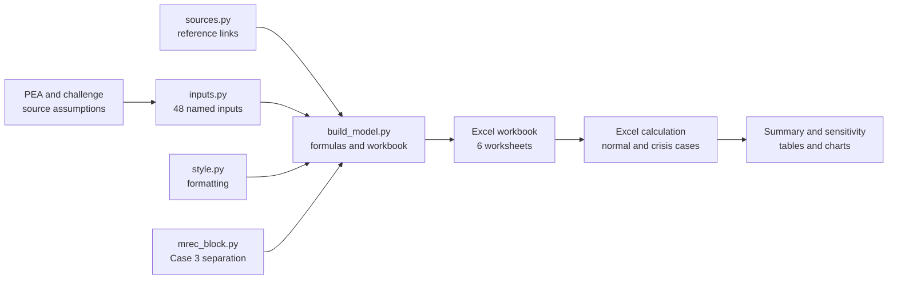

# Software architecture — submitted v1.0 model

This document describes the **team's original November 7, 2026 implementation**, not a new financial model. Source files were recovered from the teammate's final-version repository ZIP. The authoritative submitted workbook and report remain unchanged.

## How the source files fit together



The builder uses `openpyxl` to define a workbook's structure, formulas, named input cells, styling, charts, and scenario comparisons. The separate `mrec_block.py` is executed from within `build_model.py` and implements the third processing case. Its presence is essential to reproducing the final workbook.

The submitted `report/tiros_brownsville_report.pdf` is **not automatically regenerated** when workbook assumptions change. The LaTeX source and vector figures are separately preserved under `report/`.

## Six sheets in the submitted model

| Worksheet | Function |
|---|---|
| `Read Me` | Usage guide, case definitions, trust-label semantics |
| `Summary` | Model comparison, normal/crisis price NPV, case ranking and throughput comparisons |
| `Inputs` | 48 named entries with units, evidence labels and assumptions |
| `Model` | Process flows, operating economics, capital costs, pre-tax NPV and scenario calculations |
| `MREC Texas` | Conditional Texas rare-earth separation costs and economics for Case 3 |
| `Sources` | References and primary-source links |

## One worked formula from the original spreadsheet

The team's normal-price net present value calculation appears in `Model!D60:F60`. The Brazil expression in `Model!D60` is:

```excel
=-D58+(D50-D18*Sust_t)*D59/1000000
```

The expression implements the following simplified screening calculation, with *C* in US$M, *M* in US$/year, *Q* in tonnes/year, and *s* in US$/tonne:

$$
\mathrm{NPV}_{M\$}=-C_{M\$}+\frac{(M_{\$/y}-Q_{t/y}s_{\$/t})}{10^6}\,A(r,T),
\qquad A(r,T)=\frac{1-(1+r)^{-T}}{r}.
$$

For the submitted **Brazil normal-price baseline**:

- Build cost: **$53.579M** (`Model!D58`).
- Annual operating margin before sustaining capital: **$7.743M/year** (`Model!D50`).
- Ore throughput: **60,000 tonnes/year** (`Model!D18`).
- Sustaining capital: **$5.784 per tonne** (named input `Sust_t`).
- Discount rate: **8%**, project life **20 years** (named inputs `Disc` and `Life`), giving annuity factor **9.81815** (`Model!D59`).

This yields **+$19.0386M pre-tax NPV** (`Model!D60` and `Summary!D16`). The Texas and MREC processing cases use the same capital/annuity structure with their own modeled revenue and costs. The 2026-crisis calculation uses additional acid-price costs in `Model!D61:F62`.

This is a trace of the **original team's calculation logic**, not an independent validation of its underlying geology, engineering, commercial prices, or feasibility.

## Named inputs and provenance

Every major model input has a defined name (for example `P_acid_BR`, `P_acid_TX`, `Acid_t`, and `ROM_tpm`), plus a unit, source, and **Known / Assumption / Needs testing** confidence designation. The complete evidence inventory is on the workbook's `Inputs` and `Sources` tabs. Do not treat a reference-labeled assumption as a measured process parameter.

## Safe reproduction and tests

The teammate's generator originally writes directly to `model/Tiros_Brownsville_Model.xlsx`. Instead of executing that file directly in the published repository, run:

```bash
python -m pip install -r requirements.txt
python tools/rebuild_and_verify.py
python -m unittest discover -s tests -v
```

`tools/rebuild_and_verify.py` runs the **unaltered original generator in a temporary directory**, compares the six sheet names, 48 named inputs, 271 Excel formulas, and relevant static cells with the submitted file, then checks that the submitted workbook's SHA-256 has not changed. Its comparison tolerates equivalent numeric notation (for example `2.4e6` vs `2400000`) and ignores harmless XML serialization or Excel formula-cache differences.

To keep a separate generated copy without altering the final submission:

```bash
python tools/rebuild_and_verify.py --output rebuilt-v1.0.xlsx
```

The standard-library checks do **not** recalculate all Excel formulas: the model's `openpyxl` generator creates formulas but Excel normally computes the cached results. Read [Verification results](verification-results.md) for additional in-memory scenario-recalculation QA and the remaining limitations.
